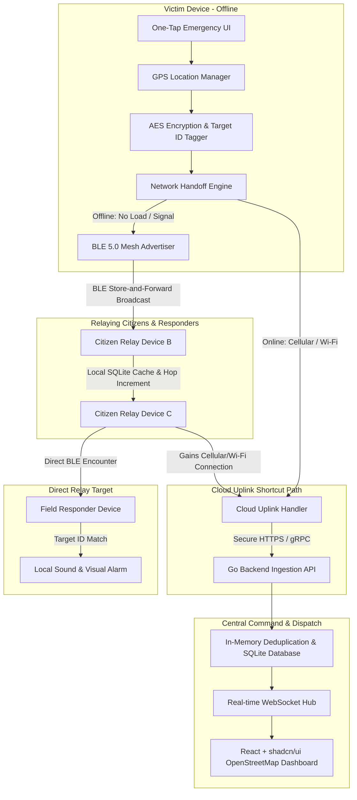
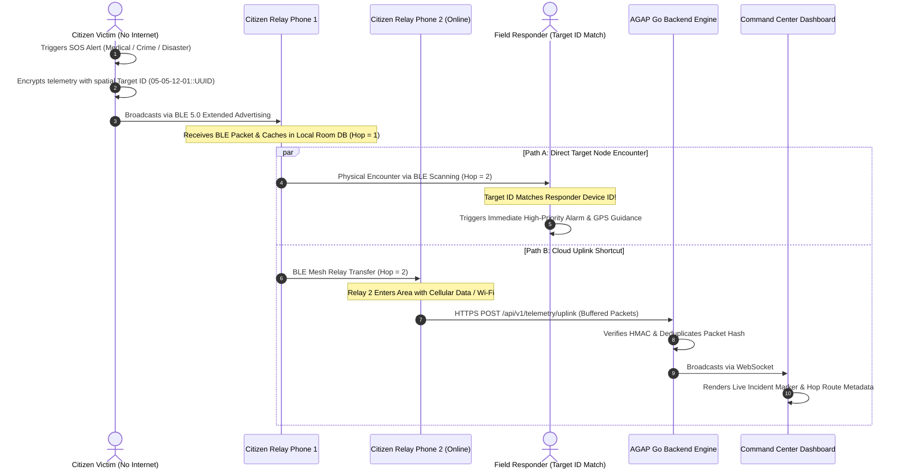
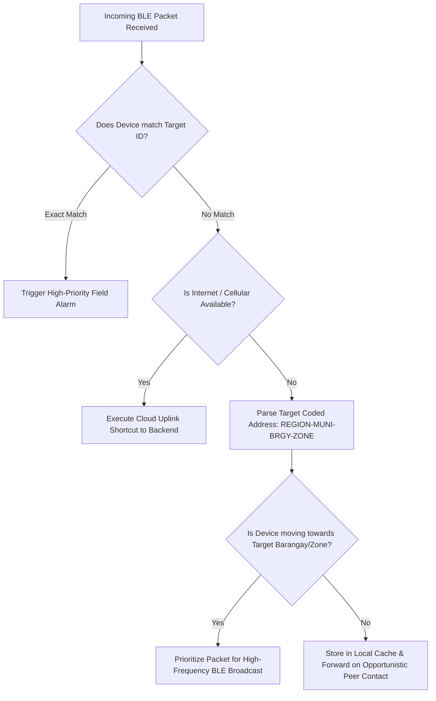
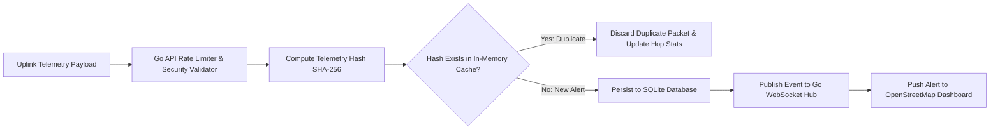
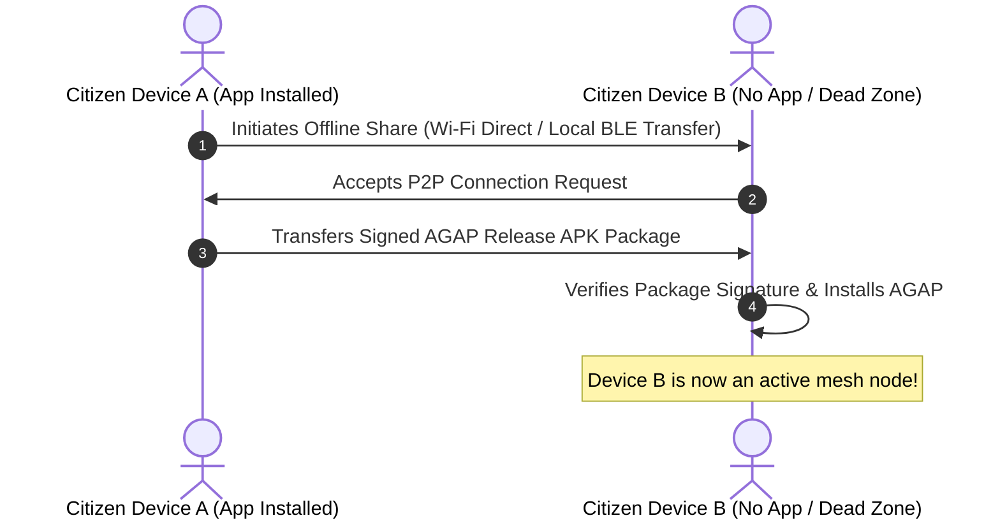

# AGAP: Accelerated Geolocation-based Assistance and Protection

> **The Hero's Gift**: An emergency response platform that delivers instant geolocation assistance via standard mobile networks and automatically falls back to peer-to-peer Bluetooth Low Energy (BLE) store-and-forward mesh telemetry when internet or mobile load is unavailable.
> 
> *Returned to the People of Ibalong by **The Fellowship (Traveling Salesman)** — Heroes of Innovation Challenge 2026, Ibalong Festival, Legazpi City.*

---

## The Fellowship
* **James Ryan S. Gallego**
* **Jay Virgil A. Romero**
* **Gil IV Miguel Salvador I. Cea**
* **Diomar B. Molina**

---

## Executive Summary & Problem Context

In emergency situations—such as sudden late-night crimes, acute medical crises, traffic collisions, or severe typhoon blackouts in Legazpi City—traditional emergency channels collapse due to:
1. **Connectivity Dead Spots**: Remote areas, concrete structures, or mountainous topography lacking cellular coverage.
2. **Mobile Load Depletion**: Citizens unable to initiate voice calls or send cellular SMS due to zero prepaid load.
3. **Infrastructure Collapse**: Power outages or physical fiber destruction during major disasters knocking out local towers.

**AGAP** solves this through a resilient **Dual-Channel Architecture**:
- **Primary Lane (Online Mode)**: Standard cellular data (4G/5G) or Wi-Fi for instant direct reporting to response centers.
- **Fail-Safe Fallback (Offline Mode)**: Automatic transition to an offline BLE store-and-forward mesh network. Encrypted distress packets containing GPS coordinates, emergency classification, timestamp, and a spatial **Target ID** hop phone-to-phone across citizens and responders until reaching a target dispatch node or a network uplink shortcut.

---

## Core Platform Features

### 1. One-Tap Distress SOS Dispatch
- Instant trigger UI for **Crime**, **Medical Emergency**, **Accident**, or **Natural Disaster**.
- High-precision GPS position resolution with background location updates.

### 2. Dual-Channel Auto-Handoff Engine
- Zero-touch network monitoring: Seamlessly routes telemetry through cellular/Wi-Fi when online.
- Instantly packages encrypted telemetry into BLE Mesh advertising packets when offline or load is depleted.

### 3. Hierarchical Spatial Target ID System
- Target IDs use a **Spatial Hierarchical Coded Address + UUID Hash** structure:
  ```text
  Target ID = {Region}-{Province}-{Municipality}-{Barangay}-{Zone/Unit} :: UUID_HASH
  ```
  *Example*: `05-05-12-01-04::4a8f9c12-3b4e-4f10-912a-87c2b3f10111` (Region V, Albay, Legazpi City, Barangay Central, Zone 4 - DRRMO Unit 1).
- Allows intermediate mesh nodes to perform coarse spatial geographic routing toward the target precinct or medical station even without exact end-node IP addresses.

### 4. Resilient Relay Mechanisms
- **Direct Target Node Relay**: Alert continues hopping device-to-device via BLE until physically encountering a responder device matching the embedded Target ID, triggering an immediate localized high-priority alert without needing cell towers.
- **Cloud Uplink Shortcut**: Any intermediate citizen device in the mesh chain that enters an area with active Wi-Fi or cellular load automatically reads accumulated cached distress packets and routes them directly to the command center's online dispatch server.

### 5. BLE 5.0 Extended Advertising + GATT Fallback Payload
- Uses **BLE 5.0 Extended Advertising** (up to 255 bytes) for fast connectionless broadcasting of encrypted distress packets.
- Includes a **GATT Service Fallback Protocol** for legacy devices limited to 31-byte legacy BLE advertising.

### 6. Offline P2P App Sharing
- Integrated **Wi-Fi Direct** and local **Bluetooth APK Transfer** enabling citizens to install AGAP phone-to-phone in dead zones during disaster outreach or grid failures without internet.

### 7. GIS Command Center Dispatcher Dashboard
- Real-time React + TypeScript interactive map powered by **Leaflet + OpenStreetMap** with **Tailwind CSS & shadcn/ui** component architecture.
- Telemetry packet deduplication, hop-count tracking, spatial incident clustering, and responder unit dispatch monitoring.

---

## Architecture & Sequence Diagrams

### 1. High-Level Dual-Channel System Architecture



---

### 2. Offline BLE Mesh Relay Sequence Diagram



---

### 3. Spatial Hierarchical Target ID Routing Flowchart



---

### 4. Telemetry Ingestion & Packet Deduplication Pipeline



---

### 5. Wi-Fi Direct & BLE Offline App Sharing Protocol



---

## Repository Directory Structure

```
AGAP/
├── .github/                      # CI/CD Workflows & GitHub actions
├── .gitignore                    # Root monorepo gitignore rules
├── .env.example                  # Root environment variable template
├── README.md                     # Main system architecture & project guide
│
├── android/                      # Android Mobile Application (Kotlin + Jetpack Compose)
│   ├── .gitignore                # Android build ignore rules
│   ├── .env.example              # Android environment configuration template
│   ├── build.gradle.kts          # Top-level Gradle configuration
│   ├── settings.gradle.kts       # Module settings
│   └── app/
│       ├── build.gradle.kts      # App module dependencies & SDK targets
│       └── src/main/java/com/travelingsalesman/agap/
│           ├── data/             # Room DB cache, Encryption, Repositories
│           ├── mesh/             # BLE 5.0 Advertiser, GATT Server, Mesh Manager
│           ├── network/          # Network Monitor, Handoff Engine, Uplink Client
│           ├── sharing/          # Wi-Fi Direct & P2P APK Sharing Manager
│           ├── ui/               # Jetpack Compose Views (SOS Button, Incident Map)
│           └── util/             # Location & Target ID Spatial Address Utilities
│
├── backend/                      # High-Performance Backend Engine (Go / Golang)
│   ├── .gitignore                # Go build ignore rules
│   ├── .env.example              # Backend environment configuration template
│   ├── go.mod                    # Go module dependencies
│   ├── main.go                   # API Router, WebSocket Hub & Gateway Entry
│   ├── config/                   # Configuration loader
│   ├── handlers/                 # Telemetry Ingestion & Dispatcher Handlers
│   ├── models/                   # Telemetry Packet & Spatial Data Models
│   ├── services/                 # Deduplication & SQLite Database Engine
│   └── websocket/                # WebSocket Client Hub for Command Center
│
└── frontend/                     # GIS Command Center Dashboard (React 19 + TypeScript + Vite + Tailwind CSS + shadcn/ui)
    ├── .gitignore                # Frontend build ignore rules
    ├── .env.example              # Frontend environment configuration template
    ├── components.json           # shadcn/ui configuration
    ├── tailwind.config.js        # Tailwind CSS configuration
    ├── package.json              # Dependencies & scripts
    ├── vite.config.ts            # Vite configuration & path aliases
    └── src/
        ├── components/           # UI Components & Incident Views
        │   └── ui/               # shadcn/ui primitive components (Button, etc.)
        ├── hooks/                # WebSocket & Telemetry Data Hooks
        ├── lib/                  # Utilities & cn helper
        ├── maps/                 # GIS Interactive Map (Leaflet + OpenStreetMap)
        ├── services/             # API Client
        └── types/                # Telemetry & Spatial Address Type Definitions
```

---

## Environment Configuration & Variables

### Root (`.env.example`)
```env
NODE_ENV=development
PROJECT_NAME=AGAP
PROJECT_REGION=Legazpi_City_PH

BACKEND_PORT=8080
FRONTEND_PORT=5173

DB_TYPE=sqlite
DB_FILE_PATH=./agap_gis.db

OSM_TILE_SERVER_URL=https://{s}.tile.openstreetmap.org/{z}/{x}/{y}.png
JWT_SECRET=super_secret_jwt_key_change_in_production
TELEMETRY_AES_KEY=0123456789abcdef0123456789abcdef
```

### Backend (`backend/.env.example`)
```env
PORT=8080
ENV=development
DB_TYPE=sqlite
DB_FILE_PATH=./agap_gis.db
JWT_SECRET=agap_backend_jwt_secret_key_2026
AES_SECRET_KEY=0123456789abcdef0123456789abcdef
CORS_ALLOWED_ORIGINS=http://localhost:5173,http://127.0.0.1:5173
```

### Frontend (`frontend/.env.example`)
```env
VITE_APP_TITLE=AGAP Command Center & Emergency Dispatch Dashboard
VITE_API_BASE_URL=http://localhost:8080/api/v1
VITE_WS_URL=ws://localhost:8080/ws
VITE_MAP_TILES_URL=https://{s}.tile.openstreetmap.org/{z}/{x}/{y}.png
VITE_MAP_ATTRIBUTION=&copy; OpenStreetMap contributors
```

### Android (`android/.env.example`)
```env
AGAP_API_URL=http://10.0.2.2:8080/api/v1
DEFAULT_TARGET_ID=05-05-12-01-04::4a8f9c12-3b4e-4f10-912a-87c2b3f10111
BLE_SCAN_INTERVAL_MS=30000
BLE_ADV_POWER_LEVEL=HIGH
GPS_HIGH_ACCURACY_ENABLED=true
AES_SECRET_PAYLOAD_KEY=0123456789abcdef0123456789abcdef
```

---

## Developer Setup & Execution Guide

### Prerequisites
- **Go**: `v1.22+`
- **Node.js**: `v20+` & `npm`
- **Android Studio**: Ladybug / Jellyfish (JDK 17+)

---

### Step 1: Clone & Configure Environments
```bash
git clone https://github.com/TravelingSalesman/AGAP.git
cd AGAP

# Create local environment files from templates
cp .env.example .env
cp backend/.env.example backend/.env
cp frontend/.env.example frontend/.env
cp android/.env.example android/local.properties
```

---

### Step 2: Run Backend Services (Go Engine)
```bash
cd backend
go mod tidy
go run main.go
```
*Backend API will run on `http://localhost:8080` with WebSocket endpoint at `ws://localhost:8080/ws`.*

---

### Step 3: Run Frontend Dispatch Dashboard (React + Vite + shadcn/ui)
```bash
cd frontend
npm install
npm run dev
```
*Open `http://localhost:5173` in your browser to access the GIS Command Center Dashboard.*

---

### Step 4: Run & Test Android Mobile App
1. Open the `/android` folder in **Android Studio**.
2. Sync Gradle files.
3. Deploy to a physical Android device (recommended for BLE Bluetooth Low Energy testing) or Android Emulator.
4. Grant **Bluetooth**, **Location**, and **Wi-Fi Direct** permissions.

---

## Comprehensive Master TODO Checklist

### Phase 1: Foundation, Environment & Security Setup
- [x] Create top-level monorepo layout (`android`, `backend`, `frontend`).
- [x] Configure comprehensive multi-tier `.gitignore` files.
- [x] Create `.env.example` templates for all modules.
- [x] Document System Architecture & Mermaid Diagrams in `README.md`.

### Phase 2: Android Core Application & Dual-Channel Handoff
- [ ] Implement Jetpack Compose One-Tap SOS UI (Crime, Medical, Accident, Disaster).
- [ ] Build `GPSLocationManager` using Fused Location Provider with fallback location caching.
- [ ] Implement `NetworkMonitor` to detect Cellular/Wi-Fi status and mobile data availability.
- [ ] Implement `HandoffEngine` to trigger instant zero-touch switching between Online HTTP Uplink and Offline BLE Mesh Advertising.
- [ ] Implement local SQLite Room Database for storing pending distress packets.

### Phase 3: BLE Mesh Store-and-Forward & Spatial Routing
- [ ] Implement `BLEAdvertiser` utilizing BLE 5.0 Extended Advertising (up to 255 bytes).
- [ ] Implement `GATTServiceFallback` for legacy BLE 4.2 devices (31-byte packet splitting).
- [ ] Implement Spatial Hierarchical Target ID encoder (`REGION-MUNI-BRGY-ZONE::UUID`).
- [ ] Build P2P Store-and-Forward mesh relay algorithm (packet hop counter, lifetime TTL, deduplication).
- [ ] Build Responder Device Mode with Target ID matching and high-priority sound/vibration alerts.

### Phase 4: Go Backend Telemetry Ingestion & Real-Time Engine
- [ ] Build REST API ingestion endpoint (`POST /api/v1/telemetry/uplink`).
- [ ] Implement SHA-256 telemetry packet hash deduplication with in-memory TTL cache.
- [ ] Integrate SQLite database engine for incident geolocation indexing.
- [ ] Build WebSocket Server Hub for streaming real-time alerts to command centers.
- [ ] Implement Target ID spatial routing verification & dispatch agency forwarding.

### Phase 5: GIS Command Center Dispatcher Dashboard
- [x] Set up React 19 + TypeScript + Vite + Tailwind CSS + shadcn/ui core application structure.
- [ ] Build interactive GIS map integration (Leaflet + OpenStreetMap) centered on Legazpi City.
- [ ] Implement real-time WebSocket telemetry listener & incident map marker overlays.
- [ ] Create Target ID spatial filtering & emergency type indicators.
- [ ] Add hop-count route visualization & responder assignment tracking.

### Phase 6: P2P App Sharing, Simulation & Deployment Readiness
- [ ] Implement Wi-Fi Direct P2P APK transfer module in Android app.
- [ ] Implement Bluetooth Local File Transfer for APK distribution.
- [ ] Conduct multi-device BLE mesh relay simulation tests in dead zones.
- [ ] Validate Cloud Uplink Shortcut with auto-upload upon rejoining cellular network.
- [ ] Prepare final production deployment guides for DRRMO & Legazpi City emergency responders.

---

## License & Acknowledgments

Developed by **The Fellowship (Traveling Salesman)** for the **Heroes of Innovation Challenge 2026** during the **Ibalong Festival 2026**, Legazpi City. Dedicated to ensuring no cry for help goes unheard.