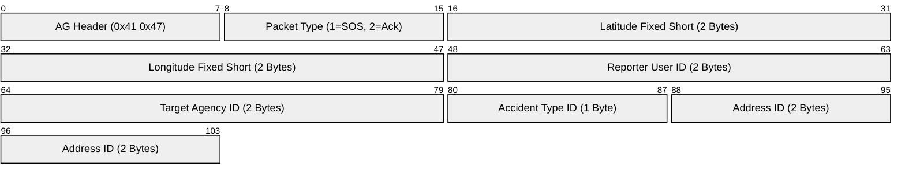
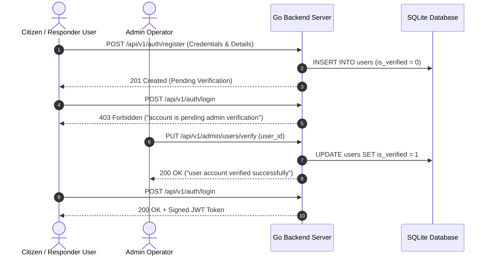

# AGAP: Accelerated Geolocation-based Assistance and Protection

> **The Hero's Gift**: An emergency response platform that delivers instant geolocation assistance via standard mobile networks and automatically falls back to peer-to-peer Bluetooth Low Energy (BLE) store-and-forward mesh telemetry when internet or mobile load is unavailable.
> 
> *Returned to the People of Ibalong by **The Fellowship (Traveling Salesman)** — Heroes of Innovation Challenge 2026, Ibalong Festival, Legazpi City.*

---

## The Fellowship
* **James Ryan Sentelices Gallego** (Team Leader)
* **Diomar Balasta Molina** (Team Member)
* **Jay Virgil Alto Romero** (Team Member)
* **Gil IV Miguel Salvador I. Cea** (Team Member)

---

## Executive Summary & Problem Context

In emergency situations—such as sudden late-night crimes, acute medical crises, traffic collisions, or severe typhoon blackouts in Legazpi City—traditional emergency channels collapse due to:
1. **Connectivity Dead Spots**: Remote areas, concrete structures, or mountainous topography lacking cellular coverage.
2. **Mobile Load Depletion**: Citizens unable to initiate voice calls or send cellular SMS due to zero prepaid load.
3. **Infrastructure Collapse**: Power outages or physical fiber destruction during major disasters knocking out local towers.

**AGAP** solves this through a resilient **Dual-Channel Architecture**:
- **Primary Lane (Online Mode)**: Standard cellular data (4G/5G) or Wi-Fi for instant direct reporting to response centers.
- **Fail-Safe Fallback (Offline Mode)**: Automatic transition to an offline BLE store-and-forward mesh network. Encrypted compact distress packets containing binary-encoded GPS coordinates, emergency classification, reporter ID, and target spatial IDs hop phone-to-phone across citizens and responders indefinitely until reaching a responder, admin station, or internet gateway.

---

## Core Platform Features

### 1. Compact 12-Byte BLE Mesh Protocol & Predefined Messages Catalog
- **Upward Distress SOS (Type 1)**: Fits inside legacy 31-byte BLE advertising frames (`12 Bytes`: Header, Coordinates, Reporter ID, Target Agency ID, Accident Type ID, Address ID).
- **Downward Ack & Dispatch Response (Type 2)**: Transmits coded status updates (`8 Bytes`: Header, Receiver User ID, Predefined Message ID, Rescue Unit ID).
- **Predefined Messages Catalog**: Pre-populated database table resolving numeric message codes (`1`=HELP_EN_ROUTE, `2`=RESCUE_DISPATCHED, `3`=MEDIC_DEPLOYED, etc.) to full localized text strings offline.

### 2. Normalized Relational Data Model & Location Hierarchy
- **Users & Multi-Attribute Tables**: Unified `users` with normalized `user_devices` (hardware UUID tracking) and `user_emergency_contacts`.
- **Geographic Division Hierarchy**: Normalized `provinces` → `municipalities` → `barangays` → `addresses` with Albay PSGC seed data.
- **Rescue Units**: `responder_units` linked to agencies and responders with unit types (`AMBULANCE`, `FIRE_TRUCK`, `PATROL_CAR`, `RESCUE_BOAT`, `FOOT_PATROL`).

### 3. User Account Admin Verification Gateway
- **Account Verification System**: Newly registered users (`CITIZEN`, `RESPONDER`) start as `is_verified = 0` (unverified).
- **Security Access Control**: Unverified users cannot enter or log into the application until an Admin approves their account via `PUT /api/v1/admin/users/verify`. Default Admin account is auto-verified.

### 4. Consolidated 3-Role Architecture
- **`CITIZEN`**: Triggers emergency SOS, views personal sent telemetry, manages emergency contacts.
- **`RESPONDER`**: Receives live mesh telemetry, views GIS map, dispatches rescue units, broadcasts downward acknowledgments.
- **`ADMIN`**: Full system administration, DB schema inspector, user account verification approval.

### 5. Indefinite Store-and-Forward Mesh Relaying
- Packets relay indefinitely phone-to-phone until reaching the target destination user (Admin/Responder or victim phone) without arbitrary drop limits. Automatic packet deduplication prevents duplicate processing.

---

## Architecture & Database Diagrams

### 1. Database Entity-Relationship (ER) Diagram


---

### 2. Compact BLE Mesh Protocol Specifications



---

### 3. User Account Verification Sequence



---

## REST API Endpoint Summary

| Method | Path | Auth Required | Description |
| :--- | :--- | :--- | :--- |
| `GET` | `/health` | Public | System health check & DB ping |
| `GET` | `/ws` | Public / Token | WebSocket real-time telemetry stream |
| `POST` | `/api/v1/auth/register` | Public | Register new user account (`is_verified` = `0`) |
| `POST` | `/api/v1/auth/login` | Public | Authenticate credentials, returns JWT token |
| `POST` | `/api/v1/auth/refresh` | Public | Refresh JWT token |
| `PUT` | `/api/v1/admin/users/verify` | Admin JWT | Verify registered user account |
| `GET` | `/api/v1/admin/db` | Admin JWT | **Live SQLite DB Explorer web UI** (see below) |
| `GET` | `/api/v1/admin/db/tables` | Admin JWT | JSON list of all tables, schemas & row counts |
| `POST` | `/api/v1/admin/db/row/insert` | Admin JWT | Insert row into any table |
| `POST` | `/api/v1/admin/db/row/update` | Admin JWT | Update row by primary key |
| `POST` | `/api/v1/admin/db/row/delete` | Admin JWT | Delete row by primary key |
| `POST` | `/api/v1/telemetry/uplink` | JWT + HMAC | Uplink distress telemetry packet |
| `GET` | `/api/v1/incidents` | JWT | List emergency incidents |
| `PUT` | `/api/v1/incidents/{id}/status` | JWT | Update incident status |
| `GET` | `/api/v1/agencies` | JWT | List emergency dispatch agencies |
| `GET` | `/api/v1/responders` | JWT | List responder units & live GPS |
| `GET` | `/api/v1/geo/provinces` | Public | List provinces (geo hierarchy) |

---

## 🗄️ Live Database Explorer — How to Access

The backend includes a built-in **SQLite DB Explorer** web UI for viewing tables, inserting, editing, and deleting records directly from your browser.

### Step 1 — Get a JWT Token

**Linux / macOS / Git Bash:**
```bash
curl -s -X POST https://homeserver.tail8010bd.ts.net/api/v1/auth/login \
  -H "Content-Type: application/json" \
  -d '{"username":"admin","password":"admin123"}'
```

**Windows CMD** *(must be one line, use `\"` for quotes inside JSON)*:
```cmd
curl -s -X POST https://homeserver.tail8010bd.ts.net/api/v1/auth/login -H "Content-Type: application/json" -d "{\"username\":\"admin\",\"password\":\"admin123\"}"
```

**Windows PowerShell:**
```powershell
$resp = Invoke-RestMethod -Method POST -Uri "https://homeserver.tail8010bd.ts.net/api/v1/auth/login" -ContentType "application/json" -Body '{"username":"admin","password":"admin123"}'
$token = $resp.token
Write-Host "Token: $token"
```

Copy the `token` value from the JSON response.

### Step 2 — Open the DB Explorer in Your Browser

Paste your token into this URL and open it directly in any browser:

```
https://homeserver.tail8010bd.ts.net/api/v1/admin/db?token=PASTE_TOKEN_HERE
```

All navigation links, table switching, CRUD forms, and schema operations will **automatically carry the token** — no re-authentication needed while browsing.

### Default Seed Credentials

| Username | Password | Role |
| :--- | :--- | :--- |
| `admin` | `admin123` | ADMIN (auto-verified) |
| `responder` | `responder123` | RESPONDER |
| `citizen` | `citizen123` | CITIZEN |

> **Note**: JWT tokens expire. If you get `invalid or expired token`, repeat Step 1 to get a fresh token.

---

## Developer Setup & Execution Guide

### Prerequisites
- **Go**: `v1.22+`
- **Node.js**: `v20+` & `npm`
- **Android Studio**: Ladybug / Jellyfish (JDK 17+)

### One-Command Concurrent Launch & Stopping

**PowerShell (Windows):**
```powershell
.\scripts\dev.ps1   # Start backend + frontend
.\scripts\stop.ps1  # Stop running backend + frontend
```

**Bash (Linux / macOS):**
```bash
chmod +x scripts/dev.sh scripts/stop.sh
./scripts/dev.sh   # Start backend + frontend
./scripts/stop.sh  # Stop running backend + frontend
```

### Environment Configuration

Copy and fill in the example env files before running:
```bash
cp .env.example .env
cp frontend/.env.example frontend/.env
cp android/.env.example android/local.properties
```

Key variables:
| Variable | Description |
| :--- | :--- |
| `VITE_API_BASE_URL` | Backend API URL (e.g. `https://homeserver.tail8010bd.ts.net/api/v1`) |
| `VITE_WS_URL` | WebSocket URL (e.g. `wss://homeserver.tail8010bd.ts.net/ws`) |
| `AGAP_API_URL` | Android API base URL |
| `JWT_SECRET` | Backend JWT signing secret (keep private!) |
| `PORT` | Backend HTTP port (default: `8081`) |

---

## License & Acknowledgments

Developed by **The Fellowship (Traveling Salesman)** for the **Heroes of Innovation Challenge 2026** during the **Ibalong Festival 2026**, Legazpi City. Dedicated to ensuring no cry for help goes unheard.