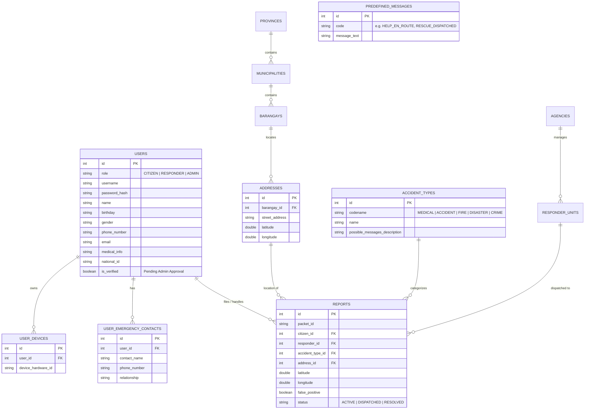
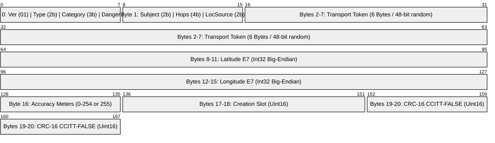
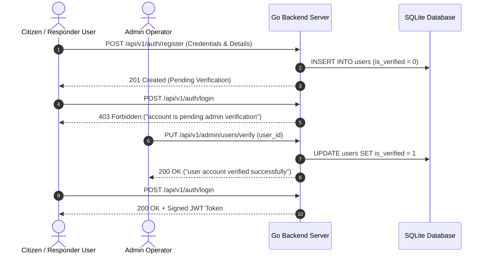

# AGAP: Accelerated Geolocation-based Assistance and Protection

> **Help is within reach.** AGAP is a community-powered emergency assistance platform that can route SOS alerts through standard mobile networks or participating peer-to-peer Bluetooth Low Energy (BLE) devices when internet access is unavailable.
>
> Built to help residents and response teams stay connected during emergencies.

**Media & identity:** [AGAP brand kit](branding/) · [Music-only visual explainer (Remotion)](remotion/)

---

## The Fellowship
* **James Ryan Sentelices Gallego** (Team Leader)
* **Diomar Balasta Molina** (Team Member)
* **Jay Virgil Alto Romero** (Team Member)
* **Gil IV Miguel Salvador I. Cea** (Team Member)

---

## Executive Summary & Problem Context

In emergency situations—such as sudden late-night crimes, acute medical crises, traffic collisions, or severe typhoon blackouts in Legazpi City—traditional emergency channels collapse due to:
1. **Connectivity Dead Spots**: Remote areas, concrete structures, or mountainous topography lacking cellular coverage.
2. **Mobile Load Depletion**: Citizens unable to initiate voice calls or send cellular SMS due to zero prepaid load.
3. **Infrastructure Collapse**: Power outages or physical fiber destruction during major disasters knocking out local towers.

**AGAP** solves this through a resilient **Dual-Channel Architecture**:
- **Primary Lane (Online Mode)**: Standard cellular data (4G/5G) or Wi-Fi for instant direct reporting to response centers.
- **Fail-Safe Fallback (Offline Mode)**: Automatic transition to an offline BLE store-and-forward mesh network. Compact 21-byte distress packets containing binary E7-encoded GPS/map coordinates, emergency classification, and location source indicators hop phone-to-phone across citizens and responders with CRC-16 error detection until reaching a responder device or internet gateway.

---

## Core Platform Features

### 1. Compact 21-Byte BLE Mesh Protocol v2 & Predefined Messages Catalog
- **Upward Distress SOS (Type 00 & 01)**: Compact 21-byte advertising frame containing Header, Metadata (Hop Count, Subject, Location Source), 6-byte Transport Token, Signed Int32 Lat/Lon E7 coordinates, Accuracy Byte, Creation Time Slot, and CRC-16 checksum.
- **Downward Ack & Status Response (Type 10 & 11)**: Transmits 13-byte coded status updates containing Header, Hop Count, Target Report Token, Status Code (`1`=SOS_RECEIVED, `2`=HELP_EN_ROUTE, `3`=RESOLVED, etc.), Creation Slot, and CRC-16 checksum.
- **Predefined Messages Catalog**: Pre-populated database table resolving numeric message codes to full localized text strings offline without requiring network connectivity.

### 2. Normalized Relational Data Model & Location Hierarchy
- **Users & Multi-Attribute Tables**: Unified `users` with normalized `user_devices` (hardware UUID tracking) and `user_emergency_contacts`.
- **Geographic Division Hierarchy**: Normalized `provinces` → `municipalities` → `barangays` → `addresses` with Albay PSGC seed data.
- **Rescue Units**: `rescue_units` linked to agencies and responders with unit types (`AMBULANCE`, `FIRE_TRUCK`, `PATROL_CAR`, `RESCUE_BOAT`, `FOOT_PATROL`).

### 3. User Account Admin Verification Gateway
- **Account Verification System**: Newly registered users (`CITIZEN`, `RESPONDER`) start as `is_verified = 0` (unverified).
- **Security Access Control**: Unverified users cannot enter or log into the application until an Admin approves their account via `PUT /api/v1/admin/users/verify`. Default Admin account is auto-verified.

### 4. Consolidated 3-Role Architecture
- **`CITIZEN`**: Triggers emergency SOS, views personal sent telemetry, manages emergency contacts.
- **`RESPONDER`**: Receives live mesh telemetry, views GIS map, dispatches rescue units, broadcasts downward acknowledgments.
- **`ADMIN`**: Full system administration, DB schema inspector, user account verification approval.

### 5. Time-Bounded Store-and-Forward Mesh Relaying & Privacy
- **Time-Bounded Relaying**: Packets hop phone-to-phone with strict TTL expiration (2-hour SOS TTL, 1-hour ACK/STATUS TTL) and a maximum 15-hop limit. Persistent deduplication prevents duplicate packet relaying.
- **Silent Background Relay**: Relay citizen devices forward packets silently in the background without exposing private victim telemetry or displaying another citizen's emergency UI.
- **Terminal Suppression**: Incident resolution (`RESOLVED` / `CANCELLED`) propagates terminal tombstones across the mesh to quench stale emergency packets.

---

## Architecture & Database Diagrams

### 1. Database Entity-Relationship (ER) Diagram



---

## Technical Documentation & Protocol Specs

- [BLE Protocol v2 Specification](file:///docs/ble-protocol-v2.md)
- [BLE v2 Test Vectors JSON](file:///docs/ble-protocol-v2-test-vectors.json)
- [Offline Mapping & OSMDroid Packaging](file:///docs/offline-map.md)
- [Data Synchronization & Gateway Enrichment](file:///docs/data-sync.md)
- [Location Sources & E7 Encoding Rules](file:///docs/location-sources.md)

---

### 2. Compact BLE Mesh Protocol Specifications (v2)



---

### 3. User Account Verification Sequence



---

## REST API Endpoint Summary

| Method | Path | Auth Required | Description |
| :--- | :--- | :--- | :--- |
| `GET` | `/health` | Public | System health check & DB ping |
| `GET` | `/ws` | Public / Token | WebSocket real-time telemetry stream |
| `POST` | `/api/v1/auth/register` | Public | Register new user account (`is_verified` = `0`) |
| `POST` | `/api/v1/auth/login` | Public | Authenticate credentials, returns JWT token |
| `POST` | `/api/v1/auth/refresh` | Public | Refresh JWT token |
| `PUT` | `/api/v1/admin/users/verify` | Admin JWT | Verify registered user account |
| `GET` | `/api/v1/admin/db` | Admin JWT | **Live SQLite DB Explorer web UI** (see below) |
| `GET` | `/api/v1/admin/db/tables` | Admin JWT | JSON list of all tables, schemas & row counts |
| `POST` | `/api/v1/admin/db/row/insert` | Admin JWT | Insert row into any table |
| `POST` | `/api/v1/admin/db/row/update` | Admin JWT | Update row by primary key |
| `POST` | `/api/v1/admin/db/row/delete` | Admin JWT | Delete row by primary key |
| `POST` | `/api/v1/telemetry/uplink` | JWT + HMAC | Uplink distress telemetry packet |
| `GET` | `/api/v1/incidents` | JWT | List emergency incidents |
| `PUT` | `/api/v1/incidents/{id}/status` | JWT | Update incident status |
| `GET` | `/api/v1/agencies` | JWT | List emergency dispatch agencies |
| `GET` | `/api/v1/responders` | JWT | List responder units & live GPS |
| `GET` | `/api/v1/geo/provinces` | Public | List provinces (geo hierarchy) |

---

## 🗄️ Live Database Explorer — How to Access

The backend includes a built-in **SQLite DB Explorer** web UI for viewing tables, inserting, editing, and deleting records directly from your browser.

### Step 1 — Get a JWT Token

**Linux / macOS / Git Bash:**
```bash
curl -s -X POST http://localhost:8080/api/v1/auth/login \
  -H "Content-Type: application/json" \
  -d '{"username":"admin","password":"admin123"}'
```

**Windows CMD** *(must be one line, use `\"` for quotes inside JSON)*:
```cmd
curl -s -X POST http://localhost:8080/api/v1/auth/login -H "Content-Type: application/json" -d "{\"username\":\"admin\",\"password\":\"admin123\"}"
```

**Windows PowerShell:**
```powershell
$resp = Invoke-RestMethod -Method POST -Uri "http://localhost:8080/api/v1/auth/login" -ContentType "application/json" -Body '{"username":"admin","password":"admin123"}'
$token = $resp.token
Write-Host "Token: $token"
```

Copy the `token` value from the JSON response.

### Step 2 — Open the DB Explorer in Your Browser

Paste your token into this URL and open it directly in any browser:

```
http://localhost:8080/api/v1/admin/db?token=PASTE_TOKEN_HERE
```

All navigation links, table switching, CRUD forms, and schema operations will **automatically carry the token** — no re-authentication needed while browsing.

### Default Seed Credentials

| Username | Password | Role |
| :--- | :--- | :--- |
| `admin` | `admin123` | ADMIN (auto-verified) |
| `responder` | `responder123` | RESPONDER |
| `citizen` | `citizen123` | CITIZEN |

> **Note**: JWT tokens expire. If you get `invalid or expired token`, repeat Step 1 to get a fresh token.

---

## Developer Setup & Execution Guide

GitHub Actions publishes tested Android APKs and selectively deploys Vercel, Supabase, and Cloudflare.
See the [CI/CD setup guide](docs/ci-cd.md) for release settings and tests, and the
[free-tier deployment runbook](docs/hosted-deployment.md) for the hosted API and Firestore standby.

### Prerequisites
- **Go**: `v1.22+`
- **Node.js**: `v20+` & `npm`
- **Android Studio**: Ladybug / Jellyfish (JDK 17+)

### One-Command Concurrent Launch & Stopping

**PowerShell (Windows):**
```powershell
.\scripts\dev.ps1   # Start backend + frontend
.\scripts\stop.ps1  # Stop running backend + frontend
```

**Bash (Linux / macOS):**
```bash
chmod +x scripts/dev.sh scripts/stop.sh
./scripts/dev.sh   # Start backend + frontend
./scripts/stop.sh  # Stop running backend + frontend
```

### Environment Configuration

Copy and fill in the example env files before running:
```bash
cp .env.example .env
cp frontend/.env.example frontend/.env
cp android/.env.example android/local.properties
```

Key variables:
| Variable | Description |
| :--- | :--- |
| `VITE_API_BASE_URL` | Backend API URL (e.g. `http://localhost:8080/api/v1`) |
| `VITE_WS_URL` | WebSocket URL (e.g. `ws://localhost:8080/ws`) |
| `AGAP_API_URL` | Android API base URL |
| `JWT_SECRET` | Backend JWT signing secret (keep private!) |
| `PORT` | Backend HTTP port (default: `8081`) |

---

## License & Acknowledgments

Developed by **The Fellowship (Traveling Salesman)**. AGAP is presented as an independent emergency assistance project dedicated to ensuring no cry for help goes unheard.
